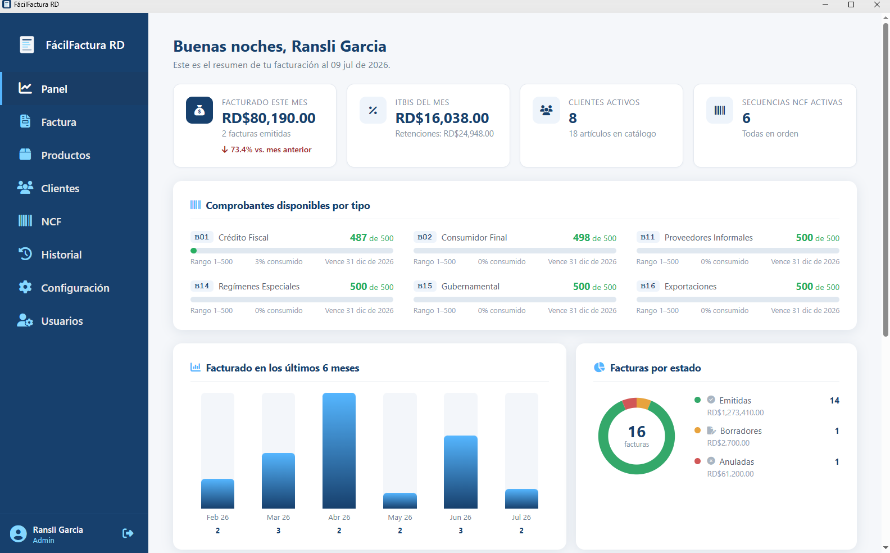
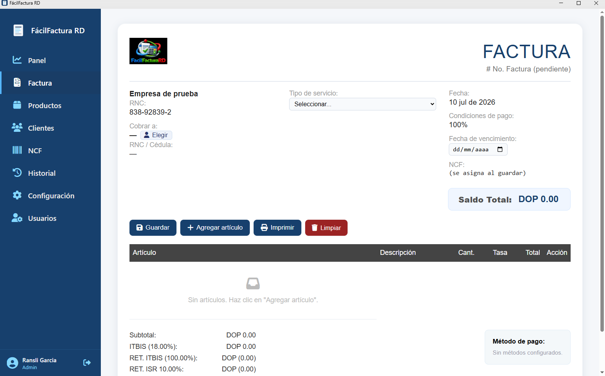
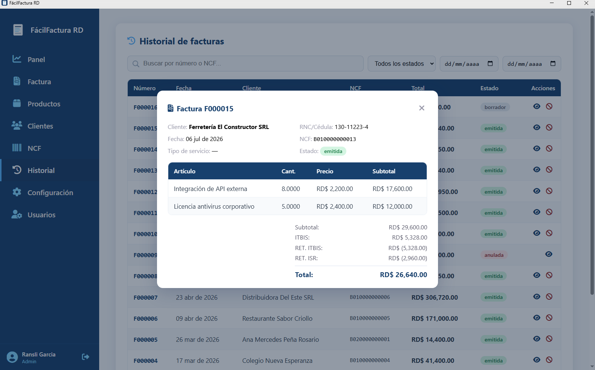
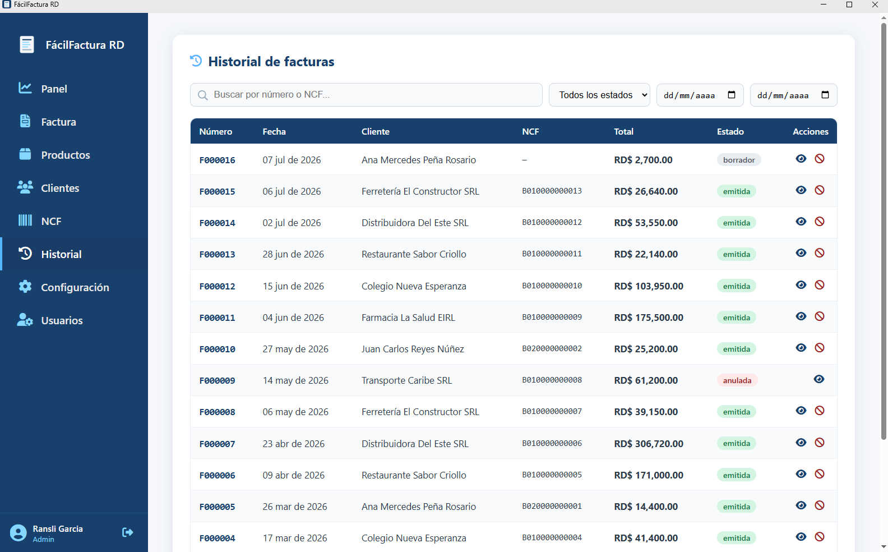
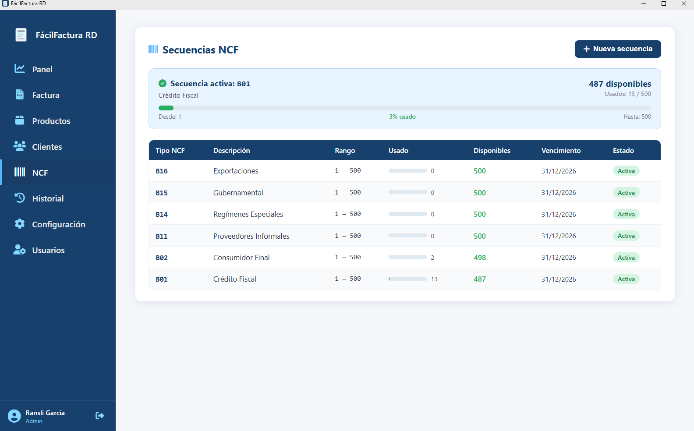
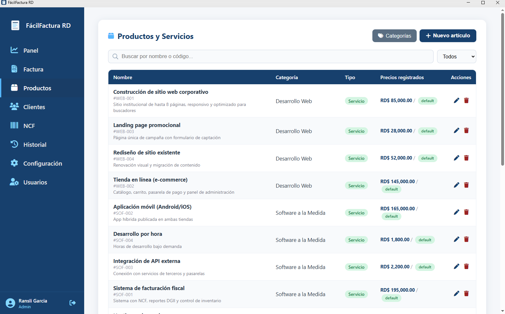
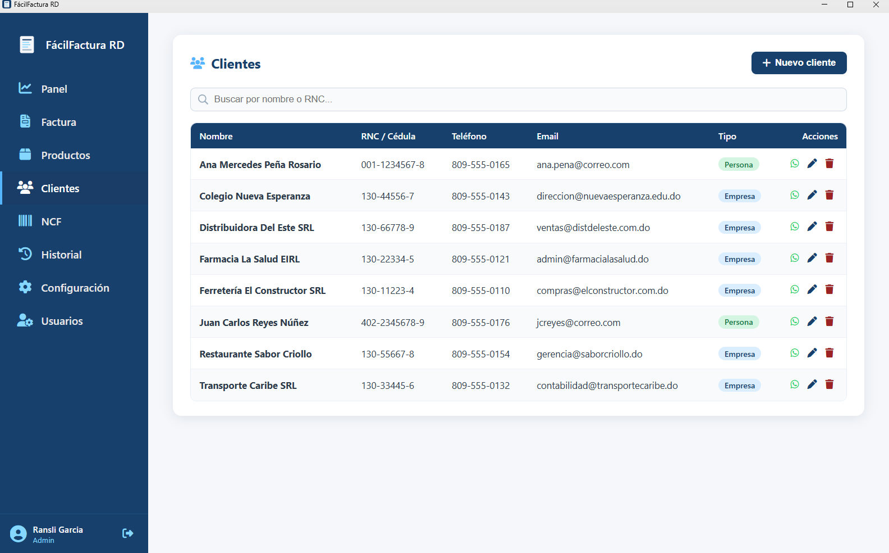
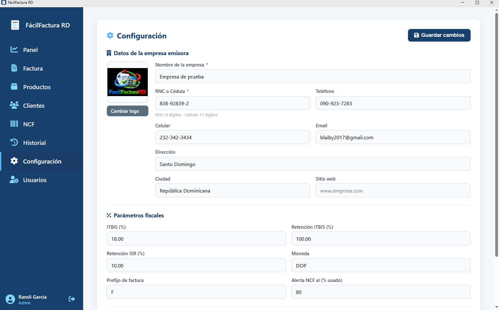
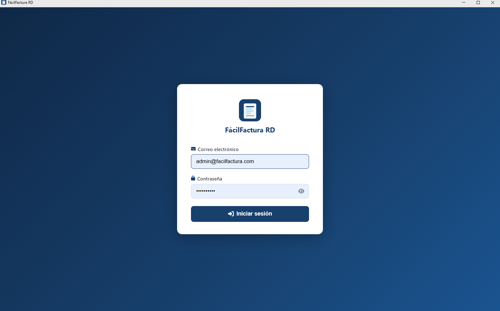

# FácilFactura RD

Plataforma SaaS multi-tenant de facturación electrónica (e-CF) con soporte de Números de
Comprobante Fiscal (NCF), conforme a los lineamientos de la DGII de la República Dominicana.
Nació en Seminario de Proyecto I como un sistema de una sola empresa, y en Seminario de
Proyecto II escaló a una sola instalación que da servicio a muchas empresas, cada una aislada
de las demás, con suscripción, firma y emisión de comprobantes fiscales electrónicos, y
contabilidad con los formatos de la DGII.

**En producción:** https://facturacion.financecore.com.do

## Descripción

FácilFactura RD es una aplicación web full-stack orientada a PYMEs dominicanas que
requieren emitir facturas con NCF válidos ante la DGII. Cada empresa suscrita gestiona sus
propios clientes, artículos, secuencias NCF y facturas, con cálculo automático de ITBIS,
retenciones e ISR, y puede emitir comprobantes fiscales electrónicos (e-CF) firmados y
transmitidos directamente a la DGII. Un equipo de plataforma administra todas las empresas
suscritas desde una consola master separada.

## Objetivo

Automatizar y simplificar el proceso de facturación de las pequeñas y medianas empresas
dominicanas, reduciendo los errores humanos en el cálculo de impuestos, garantizando el
cumplimiento de la normativa fiscal de la DGII en materia de NCF, ITBIS, retenciones y
comprobación fiscal electrónica (Ley 32-23), y ofreciéndolo como un servicio por suscripción
para que ninguna empresa tenga que instalar ni mantener nada propio.

A diferencia de las alternativas comerciales del mercado, el sistema se despliega en la
infraestructura propia del equipo y no genera costos de licencia recurrentes: todo el
stack tecnológico es de código abierto.

## Funcionalidades

**Por empresa (tenant):**
- **Autenticación JWT** con control de acceso por roles (admin, facturador, visor), aislada por empresa.
- **Gestión de clientes** (personas y empresas) con búsqueda por nombre o RNC.
- **Catálogo de productos y servicios** con múltiples precios por unidad de medida
  y soporte para artículos con dimensiones (ancho × alto, ej. banners y lonas).
- **Secuencias NCF**: registro de rangos autorizados por la DGII con **alerta automática**
  cuando la secuencia se acerca a su límite.
- **Emisión de facturas** con asignación automática del NCF, cálculo de ITBIS, retención de
  ITBIS y retención de ISR, o como **comprobante fiscal electrónico (e-CF 31/32)** firmado
  (XMLDSig) y transmitido a la DGII, con representación impresa, código QR y cola de reintentos.
- **Contabilidad**: gastos con retenciones de ITBIS e ISR, formatos DGII 606 a 609 descargables
  por período, borrador del IT-1, y una bandeja de e-CF recibidos de proveedores que lee el XML
  y precarga el gasto.
- **Historial de facturas** con filtros por estado, fecha y número/NCF, vista de detalle y anulación.
- **Configuración**: datos de la empresa emisora, logo, certificado digital, parámetros fiscales
  y métodos de pago.
- **Alta por autoservicio**: una empresa nueva se registra, elige un plan y crea su administrador
  sin intervención del equipo.

**Consola master (equipo de la plataforma):**
- Dashboard con métricas globales (empresas por estado, ingreso recurrente, pagos y facturación
  del mes, próximas a vencer).
- Gestión de empresas: perfil completo, cambio de plan, suspender/reactivar/cancelar/exentar,
  registrar pagos, e impersonar una empresa en modo ver (solo lectura) o editar, para soporte.
- Catálogo de planes (alta, edición, activación) y bitácora de pagos y cambios de plan de toda
  la plataforma.
- Paleta de color propia (morado/dorado), distinta de la app de empresa, para no confundir
  en qué contexto se está trabajando.

## Tecnologías

**Frontend:** React 18 · Vite · CSS puro
**Backend:** Node.js · Express · JWT · bcryptjs · Multer · MySQL2 · Knex
**Base de datos:** MySQL / MariaDB (27 tablas, solo por migraciones versionadas)
**Facturación electrónica:** node-forge (certificados) · xml-crypto (firma XMLDSig) · qrcode
**Infraestructura:** VPS propio · nginx · PM2 · Let's Encrypt · Cloudflare DNS · GitHub Actions (CI)

## Estructura del proyecto

```
facilfactura-rd/
├── package.json          # scripts para levantar todo el proyecto
├── backend/              # API REST (Express)
│   ├── config/           # conexión a la base de datos
│   ├── middleware/       # autenticación y roles
│   ├── routes/           # endpoints por módulo
│   ├── seed-usuarios.js  # usuarios iniciales
│   ├── seed-ncf.js       # secuencias NCF de los 6 tipos de comprobante
│   ├── seed-demo.js      # empresa, clientes, catálogo y facturas de ejemplo
│   └── fix-acentos.js    # repara acentos si el schema se importó sin utf8mb4
├── frontend/             # SPA (React + Vite)
│   └── src/
│       ├── vistas/       # Panel, Factura, Productos, Clientes, NCF, Historial, Configuración
│       ├── components/   # menú lateral, toasts, modal de categorías
│       ├── utils/        # formato de RNC/cédula, autoguardado del borrador
│       └── context/      # contexto de autenticación
├── database/
│   └── schema.sql        # 14 tablas con relaciones FK
└── docs/
    └── capturas/         # capturas de pantalla del sistema en funcionamiento
```

## Instalación y ejecución

### Requisitos previos
- Node.js v18+
- MySQL o MariaDB (XAMPP sirve para desarrollo local)
- Git

### 1. Clonar el repositorio
```bash
git clone https://github.com/Ransli/facilfactura-rd.git
cd facilfactura-rd
```

### 2. Crear la base de datos
La plataforma usa la base `facilfactura_saas`, que se construye con migraciones (Knex):
```bash
cd backend
npm run db:create      # crea la base vacía
npm run db:migrate     # aplica las migraciones de database/migrations/
npm run db:copy-v1     # opcional: copia los datos de la v1 (facilfactura_db) si la tienes
cd ..
```
El esquema completo también está en un solo archivo, `database/schema-saas.sql`
(`mysql -u root -p < database/schema-saas.sql`). Se genera con `npm run db:dump-schema`; no se edita a mano.
`database/schema.sql` es el esquema original de la v1 y se conserva como referencia histórica.

### 3. Configurar el backend
```bash
cd backend
cp .env.example .env      # edita las credenciales de MySQL y el JWT_SECRET
cd ..
```

### 4. Instalar dependencias (raíz, backend y frontend)
```bash
npm run install:all
```

### 5. Cargar los datos iniciales
```bash
cd backend
node seed-usuarios.js   # usuarios del sistema
node seed-ncf.js        # secuencias NCF de los 6 tipos de comprobante
node seed-demo.js       # opcional: empresa, clientes, catálogo y facturas de ejemplo
cd ..
```
Los tres scripts son idempotentes: si se ejecutan dos veces no duplican nada.
`seed-usuarios.js` crea tres usuarios de prueba:

| Rol         | Email                          | Contraseña     |
|-------------|--------------------------------|----------------|
| admin       | admin@facilfactura.com         | Admin2025!     |
| facturador  | facturador@facilfactura.com    | Factura2025!   |
| visor       | visor@facilfactura.com         | Visor2025!     |

> Si ya tenías la base creada antes de este cambio y ves acentos rotos
> (`Dise?o gr?fico`), ejecuta `node fix-acentos.js` desde `backend/`.

### 6. Levantar el proyecto (backend + frontend juntos)
```bash
npm run dev
```
- Frontend: http://localhost:5175
- API:      http://localhost:3002/api

> También puedes ejecutarlos por separado con `npm run dev:backend` y `npm run dev:frontend`.

### 7. Ejecutar las pruebas
```bash
npm test --prefix backend
```
Crea y migra una base propia (`facilfactura_test`) y ejecuta las pruebas de integración de la API. Nunca toca
`facilfactura_saas`. GitHub Actions corre las mismas pruebas y la compilación del frontend en cada push.

## Capturas de pantalla

### Panel de control

Resumen del facturado del mes, consumo de las secuencias NCF, evolución de los últimos
seis meses y distribución de las facturas por estado.



### Emisión de facturas

Cálculo automático de ITBIS, retenciones e ISR, con asignación del NCF al guardar.



### Detalle de un comprobante emitido

Factura con su NCF asignado y el desglose fiscal completo.



### Historial de facturas

Filtros por número, NCF, fecha y estado. Las facturas anuladas conservan su NCF.



### Secuencias NCF

Rangos autorizados por la DGII, con alertas de agotamiento y vencimiento.



### Catálogo de productos y servicios



### Gestión de clientes

Validación y formato automático de RNC (9 dígitos) y cédula (11 dígitos).



### Configuración fiscal



### Inicio de sesión



## Escalación a plataforma SaaS (Seminario de Proyecto II)

Este repositorio evolucionó de un sistema de una sola empresa (v1, Seminario de Proyecto I) a una
plataforma SaaS multi-tenant con facturación electrónica (e-CF) y contabilidad. La v1
(`facilfactura_db`) se conserva intacta como evidencia; la plataforma escalada corre sobre una base
nueva (`facilfactura_saas`), creada siempre por migración.

**Módulos completados y en producción:** `platform-db` (base técnica), `tenancy` (aislamiento
multi-tenant), `subscription` (planes y suscripción), `onboarding` (alta de empresas autoservicio),
`master-console` (administración de la plataforma), `ecf-signing` y `ecf-connector` (certificado
digital, firma y emisión de e-CF 31/32/34), `accounting` (contabilidad y reportes DGII 606-609) y
`ecf-receiver` (bandeja de e-CF recibidos de proveedores). Respaldado por **536 pruebas
automatizadas** (`npm test --prefix backend`) y una integración continua (GitHub Actions) que corre
esa misma suite y la compilación del frontend en cada push.

**Trabajo futuro:** escáner de facturas de gasto por OCR (`expense-scanner`) y la certificación real
de la plataforma ante la DGII (trámite externo, fuera del alcance de este curso).

La documentación completa del trabajo de escalación está en `docs/escalacion/`: el mapa de
capacidades, la especificación técnica de cada módulo (`SPEC-*.md`) y la guía de integración. Para
desplegar la plataforma en un servidor, ver [`docs/DESPLIEGUE.md`](docs/DESPLIEGUE.md).

## Autores

Proyecto iniciado por el **Grupo I** en Seminario de Proyecto I (ISW410), trimestre Mayo–Julio 2026,
y escalado a plataforma SaaS en Seminario de Proyecto II (ISW411), trimestre Agosto–Octubre 2026.
Escuela de Ingeniería y Tecnología, Universidad Abierta para Adultos (UAPA). Facilitador: Ing. Henry
Candelario.

| Integrante | Matrícula | Aportes en Seminario I | Aportes en Seminario II |
|---|---|---|---|
| **Ransli Rafael García Amarante** | 100044493 | Arquitectura, base de datos, autenticación, facturación, panel de control e interfaz de usuario | Arquitectura de la plataforma, base de datos multi-tenant, aislamiento por empresa, suscripción, consola master, firma digital y conector e-CF |
| **Carlos Batista** | 100056995 | Módulos de backend: clientes, categorías, unidades de medida, artículos y NCF | Contabilidad y reportes DGII (606-609), gastos y retenciones, bandeja de e-CF recibidos |

## Licencia

Distribuido bajo licencia MIT. Ver el archivo [LICENSE](LICENSE) para más detalles.
